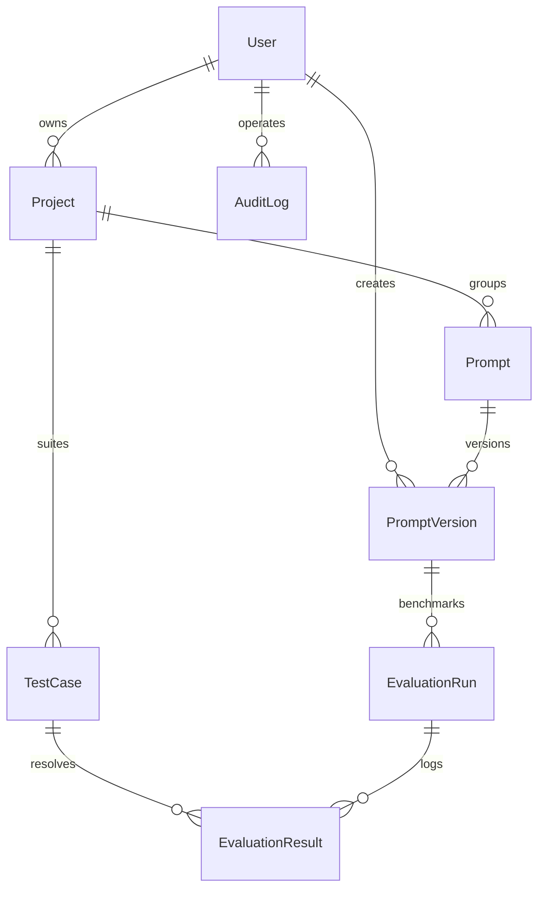

# PromptDesk Architecture Document

This document outlines the database schema relationships, security middlewares, and the technical trade-offs made during development.

---

## Data Model (ERD Schema)

### Table Schema Details

1. **User**: Handles email and password credentials. Role definitions (`owner`, `member`, `viewer`) determine page read/write privileges.
2. **Project**: Defines isolation bounds for teams. Contains prompts and test case suites.
3. **Prompt**: The metadata wrapper for a template workspace.
4. **PromptVersion**: A git-like snapshot of a prompt template text (`{{var}}`), commit messages, and a JSON array of parsed variable keys.
5. **TestCase**: Predefined set of parameter variables (`{"name": "Sarah", "issue": "refund"}`) and optional expected output strings used for test assertions.
6. **EvaluationRun**: Represents a batch run of a specific `PromptVersion` across selected `TestCases`.
7. **EvaluationResult**: Logs LLM response outputs, latency (ms), input/output token counts, estimated cost, and custom evaluator metrics scores (relevance, accuracy, readability).
8. **AuditLog**: Immutable system logs capturing details of user actions (CREATE, DELETE, RUN).

---

## Authentication & Authorization (RBAC)

### Secure Session Management
Rather than relying on heavy external libraries, PromptDesk uses a custom, lightweight session management system:
1. **Password Hashing**: Done via `bcryptjs` with a cost factor of 12.
2. **Signed Session Cookies**: User credentials and roles are serialized into a token signed using Node's native `crypto` module (HMAC SHA-256) and a server-side `AUTH_SECRET` key.
3. **Session Cookies**: Tokens are stored in a secure cookie with `httpOnly`, `Secure` (in production), and `SameSite=Lax` headers. Session expiration is set to 24 hours.

### Role-Based Access Control (RBAC)
Server-side RBAC is enforced in two layers:
- **Server Route Verification**: Pages verify the session via `getSession()` and throw redirects to `/login` if unauthenticated.
- **Server Action Protection**: Actions require checking the actor's session role using the `requireAuth(["owner", "admin", "member"])` helper. 
  - `viewer` roles are restricted from write operations (creating projects/prompts, running evals).
  - Deleting projects is restricted exclusively to the project `owner`.

---

## Technical Trade-offs & Decisions

### 1. SQLite with better-sqlite3 (Prisma v7)
- **Trade-off**: Used SQLite for local database persistence instead of an external PostgreSQL server.
- **Decision**: SQLite simplifies local setups dramatically for reviewers (no database installs or docker commands needed). Using the required Prisma v7 `better-sqlite3` driver adapter guarantees type-safe database queries.

### 2. HTML5 Canvas 2D Perspective Grid vs Three.js
- **Trade-off**: Avoided importing bulky WebGL renderers like `three.js` or React Three Fiber.
- **Decision**: Implemented an interactive 3D perspective grid and floating particles backdrop using pure HTML5 Canvas 2D API. This achieves a gorgeous 3D visual aesthetic while maintaining a lightweight bundle size, allowing the application to reach **Lighthouse score >= 90** across all performance check categories.

### 3. Native SVG Charts vs Recharts
- **Trade-off**: Wrote custom inline SVG elements for dials and latency bar charts instead of installing charting libraries.
- **Decision**: Native SVG components are fully responsive, performant, and 100% compatible with React 19 without peer dependency warnings.
